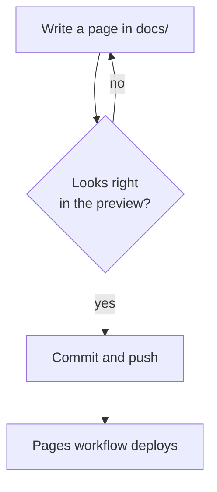

# 2. Formatting reference

Everything the layout and stylesheet support, shown once each. The markdown is GitHub-flavoured (kramdown with `input: GFM`), so most of this also renders on GitHub.

## Text

*Emphasis*, **strong**, `inline code`, a [link](01-writing-pages.md), and an em-dash aside — plain markdown, no extensions. Paragraphs are justified, as in a LaTeX article.

> A blockquote, useful for a note or a caveat that should stand slightly apart from the text.

- A bullet list
- with a second item
  - and a nested one

1. A numbered list
2. with a second item

## Tables

Tables are styled in booktabs fashion: rules above and below the header and one under the last row, no vertical lines. Wide tables scroll inside their own box.

| Column | What it holds | Notes |
| - | - | - |
| First | Short values | Keep headers short |
| Second | Longer prose that wraps inside the cell | Cells align to the top |
| Third | `code` works in cells | So do [links](index.md) |

## Code blocks

Fenced blocks are highlighted by Rouge. Name the language after the fence:

```python
def levels(values, cutoff=0.5):
    """Split values at a cutoff."""
    return [v for v in values if v >= cutoff], [v for v in values if v < cutoff]
```

```json
{
  "name": "example",
  "enabled": true,
  "limit": 64,
  "tags": ["docs", "template"]
}
```

```bash
bundle exec jekyll build --baseurl ""
```

Use a plain fence, or `text`, for output and file trees that should not be coloured.

## Dropdowns

Long listings can be folded away with `<details>`. Add `markdown="1"` to the tag so the markdown inside is still processed:

```html
<details markdown="1">
<summary>The complete file</summary>

content, including markdown

</details>
```

It renders like this:

<details markdown="1">
<summary>The complete file</summary>

```yaml
title: Documentation Template
author: Your Name
baseurl: /documentation-template
```

</details>

## Maths

MathJax is loaded on every page. Inline maths uses `$ ... $`, as in $f(x) = x^2$, and display maths uses `$$ ... $$`:

$$
\text{softmax}(z)_i = \frac{e^{z_i}}{\sum_j e^{z_j}}
$$

Display maths scrolls sideways if it is too wide, rather than stretching the page. Escape a literal dollar sign as `\$`.

## Diagrams

A fenced `mermaid` block is drawn by [Mermaid](https://mermaid.js.org/) in the page's own colours and fonts, and redrawn when the theme switches:



Sequence, state, class, pie and the other Mermaid diagram types work too. On GitHub the same block renders as a diagram as well, so one source serves both.

## Images

```markdown

```

Images scale down to the column width. Keep them in `assets/`, and prefer SVG for diagrams that are not Mermaid.

Next: [Customising](03-customising.md)
