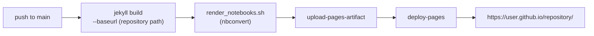

# 4. Publishing

## GitHub Pages

`.github/workflows/pages.yml` builds the site and deploys it on every push to `main`, and on demand from the *Actions* tab:

To switch it on, set *Settings > Pages > Source* to *GitHub Actions* once. The workflow needs no secrets: it uses the repository's own `pages: write` and `id-token: write` permissions. Forks work the same way, and so do private repositories on plans where Pages is available.

If your default branch is not `main`, change the branch in the `on: push` trigger.

## The base path

The workflow passes `--baseurl` from `actions/configure-pages`, so the published site always gets the right prefix, whatever `baseurl` says in `_config.yml`. That is why the local value only matters for previews.

For a custom domain, add a `CNAME` file at the repository root containing the domain, set the domain in *Settings > Pages*, and set `baseurl` to an empty string so local previews match.

## llms.txt

`llms.txt` at the repository root is a plain-text index for language models: the project in one paragraph, the key points, then one line per page. Keep it current when you add or rename pages — it is not generated.

## A publishing checklist

- `title`, `description` and `author` in `_config.yml` are yours, not the placeholders
- `baseurl` matches the repository name, or is empty for a custom domain
- the contents list in `docs/index.md` links every page, in order
- each page ends with a link to the next one
- every notebook in `notebooks/` is linked from the contents, and `make test` runs them clean
- `llms.txt` matches the pages that exist
- `README.md` describes your project
- `LICENSE.md` names the right copyright holder
- the local preview builds without warnings

Next: [Notebooks](05-notebooks.md)
