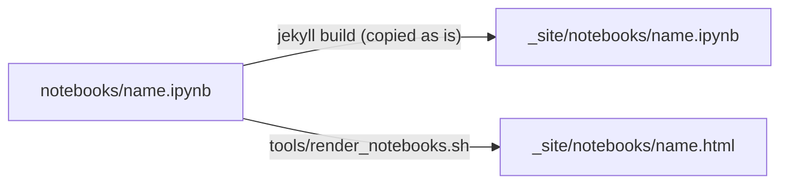

# 5. Notebooks

## A notebook is a page

Every Jupyter notebook in `notebooks/` is published as a page of the site, next to the pages from `docs/`. Nothing else needs doing: put the notebook there, link it from the contents, and push.



The deploy workflow runs `tools/render_notebooks.sh` after Jekyll. It turns each notebook into HTML with `jupyter nbconvert`, using JupyterLab's own look rather than the site's, so outputs, plots and widgets appear as they do in Jupyter. The `.ipynb` file is published too, so readers can download it and run it.

The notebook is rendered as saved: nothing is executed during the build. Run it and save it with its outputs if you want readers to see them, or clear the outputs if they should run it themselves.

## Links

Write links in their source form, so they work on GitHub and in an editor too. The render script rewrites them on the built site only:

| From | Write | On the site |
| - | - | - |
| a page in `docs/` | `[Example](../notebooks/00-example.ipynb)` | the rendered notebook |
| a notebook | `[Writing pages](../docs/01-writing-pages.md)` | the page `/01-writing-pages/` |
| a notebook | `[Other](01-other.ipynb)` | the other rendered notebook |

Anchors survive the rewrite: `../docs/02-formatting.md#maths` goes to that heading.

## Maths, diagrams and code

Markdown cells take `$...$` maths and `mermaid` code blocks, which nbconvert renders on the page, as JupyterLab 4.1 and later does in the editor. Every code cell gets the same **copy** button as code blocks on the other pages: `assets/js/copy-code.js` and `assets/css/notebook.css` are added to each rendered notebook.

## Running them all

```bash
make test
```

executes every notebook top to bottom in a temporary directory, leaving the files in `notebooks/` untouched, and fails if any cell raises an error. It needs `jupyter` on the path; pass `JUPYTER=~/venv/bin/jupyter` if it lives in a virtual environment.

## No notebooks

If your project has none, delete `notebooks/`. The render step then does nothing, and you can drop it from `.github/workflows/pages.yml` and `docker-compose.yml`.

Back to the [contents](index.md).
