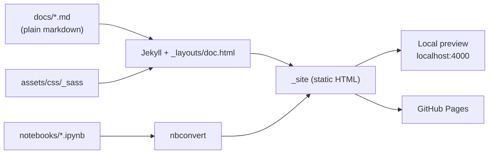

# Documentation Template

A small [Jekyll](https://jekyllrb.com/) template for documentation that is written as plain markdown in `docs/`, reads well on GitHub, and builds into a static website with a LaTeX-article look, maths, diagrams and a light/dark switch.

**How it works:** every markdown file in `docs/` becomes one page, and every Jupyter notebook in `notebooks/` becomes one more. The files need no front matter, so the same text reads cleanly in a repository browser and on the site. Pushing to `main` builds and deploys it to GitHub Pages.

## Contents

0. [Getting started](00-getting-started.md): copy the template, replace the placeholders, preview it
1. [Writing pages](01-writing-pages.md): files, titles, order, and links between pages
2. [Formatting reference](02-formatting.md): code, tables, dropdowns, maths, diagrams
3. [Customising](03-customising.md): configuration, styling, layout and includes
4. [Publishing](04-publishing.md): GitHub Pages, custom domains, and `llms.txt`
5. [Notebooks](05-notebooks.md): Jupyter notebooks as pages of the site

An [example notebook](../notebooks/00-example.ipynb) shows how a notebook looks on the site.

Replace these pages with your own; they are examples, not fixed structure.
